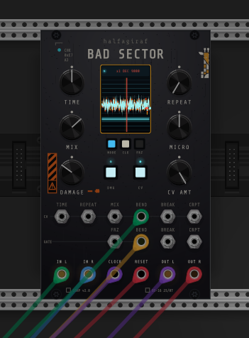
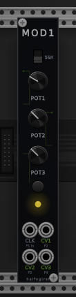
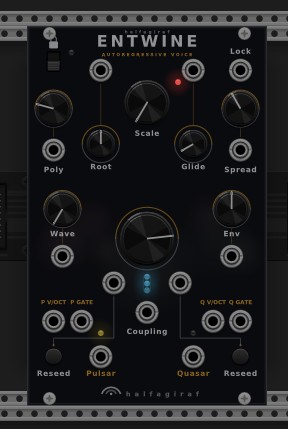
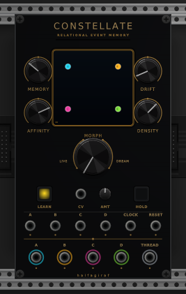
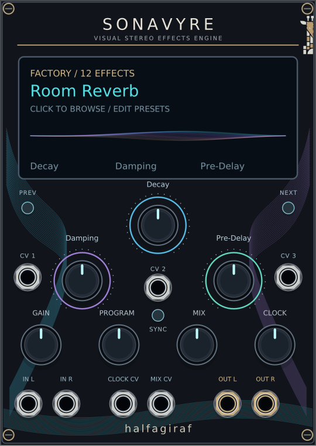

# halfagiraf Modules

VCV Rack 2 modules by halfagiraf.

## Modules

### [Bad Sector](docs/BadSector.md)

<p align="center"></p>

A stereo buffer-corruption effect for broken, repeating and degraded playback. Bend, Break and Corrupt can be clocked to the same timing grid.

[](https://www.youtube.com/watch?v=EV3uuw9fdKU)

### [MOD1](docs/MOD1.md)

<p align="center"></p>

Three bipolar random-voltage outputs with smooth and sample-and-hold modes. It runs from its own clock or an external one.

### [Entwine](docs/Entwine.md)

<p align="center"></p>

A 16-voice autoregressive synthesizer built around two interlaced streams, Pulsar and Quasar. It can free-run, follow a clock, or send V/Oct and gates to other voices.

### [Constellate](docs/Constellate.md)

<p align="center"></p>

Learns the relationships between four trigger streams, then uses that memory to produce related variations. THREAD outputs the confidence of each generated choice as CV.

[Watch the 15-second Constellate demo](docs/Constellate-demo.mp4)

### [Grainloom](docs/Grainloom.md)

<p align="center"></p>

Granular textures, frozen loops and wavetable voices, using Emilie Gillet's Beads DSP.

### [SONAVYRE Free](docs/Sonavyre.md)

<p align="center"></p>

A visual stereo effects engine with 12 factory effects, from spacious Black Hole, Cloud and Hall reverbs to plate reverb, stereo and ping-pong delays, chorus, flanger, tremolo and pitch shifting.

Three controls adapt to the selected effect. Shape the sound with stereo input gain, wet/dry mix, variable engine clock, CV modulation and three internal LFOs. Save your own presets, favourite factory effects and watch the display respond to the audio.

Included in the upcoming **2.2.0** family update.

## Install

Download the package for Windows x64, Linux x64, macOS Intel or Apple Silicon from
[GitHub Releases](https://github.com/stevenmcsorley/halfagiraf-modules/releases/latest).
Requires Rack 2.6.6 or newer.

Close Rack, open its user folder and copy the `.vcvplugin` into the matching
`plugins-win-x64`, `plugins-lin-x64`, `plugins-mac-x64` or
`plugins-mac-arm64` directory. Start Rack again and search for the module by name.

[Grainloom manual](docs/Grainloom.md) · [Example patch](docs/patches/Grainloom-demo.vcv)

The VCV Library update may arrive later than the GitHub release. Library
subscription filters can hide a new module until that update is available.

## Build

With the VCV Rack SDK in the adjacent `Rack-SDK` directory:

```sh
make test
make -j4
make dist
```

## License

GPL-3.0-or-later. Panel artwork © halfagiraf. Grainloom uses Emilie Gillet's
Mutable Instruments Beads DSP and stmlib under their original MIT licences.
See [attribution](LICENSE-Beads.txt) and the module manuals.
