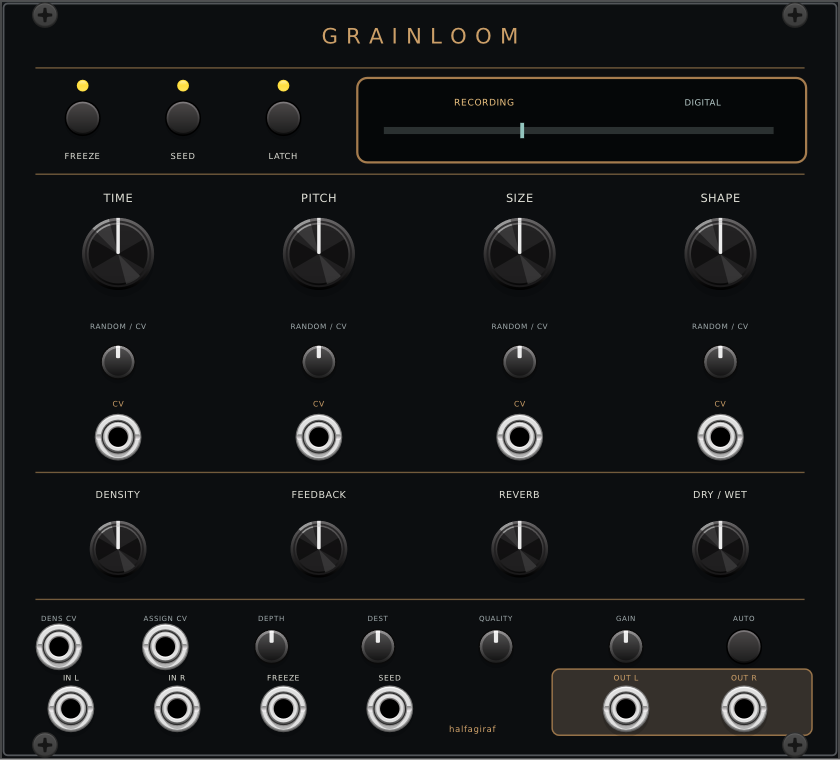

# Grainloom

Grainloom records audio and weaves it into grains, loops and evolving textures.
It uses Emilie Gillet's original open-source Mutable Instruments Beads DSP.
The halfagiraf panel is an original 28 HP design.

## Grain controls

| Control | Behaviour |
|---|---|
| TIME | Chooses recent through older recorded audio. In wavetable mode, scans the current bank. |
| PITCH | -24 to +24 semitones, with the original interval detents. Pitch CV tracks 1 V/oct. |
| SIZE | Reverse grains below the first third, shortest grains around one third, increasingly long forward grains above it. At the upper end it transitions to continuous delay. |
| SHAPE | Morphs the original square, decay, bell and reverse envelopes. |
| DENSITY | Periodic generation counterclockwise, stopped around the middle, stochastic generation clockwise. With a clock and latched SEED, it selects divisions or probability. |

The four RANDOM / CV controls use the original attenurandomizer law. With a cable
connected, turning clockwise adds positive CV modulation; turning counterclockwise
uses positive CV to control internal random modulation. With no cable, either
direction adds the original internal randomisation, with different distributions.
The behaviour in delay and wavetable modes uses the original slow random walks.
New grains capture their own parameters; their envelope and playback settings
are not continually replaced by subsequent knob movements.

## Seed and recording

SEED runs generation while held. Holding it for 1.5 seconds latches generation.
LATCH is a direct shortcut to the same latched state. Pressing SEED again clears
the latch. Holding SEED while pressing FREEZE also latches generation.
FREEZE toggles the recording freeze. Its gate input is ORed with that button state.
Grains continue playing while recording is frozen.

With latched SEED and an external clock, DENSITY chooses the original divisions
1, 2, 3, 4, 6, 8, 12 and 16 on its periodic side and probability on its random side.
Unlatched SEED combines its button and external gate for gated or single-grain
generation. Audio-rate input follows the original trigger generator's tracking
and hysteresis. The original SEED input delay is 2.5 ms.

## Texture and mixing

FEEDBACK recirculates processed audio with the original media-dependent limiting.
REVERB controls the original stereo reverb's amount and decay together.
DRY / WET uses the original mixing curve.

QUALITY selects Digital, Vintage digital, Clean tape and Dirty cassette. The knob
is numbered in the source's cassette-to-digital order. The display shows the
effective mode; changes are deferred while frozen.

| Quality | Codec/DSP input rate | Recording | Approximate stereo / mono capacity |
|---|---:|---|---|
| Digital | 48 kHz | 16-bit | 4 / 8 seconds |
| Vintage digital | 32 kHz | 12-bit | 8 / 16 seconds |
| Clean tape | 48 kHz; original 2:1 wet path | 24 kHz, 12-bit | 10.67 / 21.33 seconds |
| Dirty cassette | 24 kHz | 8-bit mu-law; original wow/flutter | 16 / 32 seconds |

GAIN at zero enables original automatic input gain calibration. Values 1-255
select its manual gain range, up to x40. AUTO restarts calibration and returns
GAIN to zero. Calibration ignores the first second and learns over five more
seconds, then retains the original protective gain behaviour.

## Connections

Audio inputs accept mono on either side. With both connected, recording is stereo.
Rack audio is converted at 10 V per full-scale codec unit and limited at that
conversion boundary. Audio outputs use the same scale. The continuous wavetable
oscillator is consequently about 10 V peak-to-peak.

TIME, SIZE and SHAPE CV use 5 V per normalized parameter unit and saturate at
the firmware's +/-1.6 range. PITCH uses 12 semitones per volt and saturates at
the firmware's +/-60-semitone input range. DENSITY and ASSIGN CV use 5 V per unit,
with +/-1 limits. Gate inputs use 1 V rising and 0.1 V falling thresholds.

ASSIGN CV can modulate FEEDBACK, DRY / WET, REVERB or their combined assignment.
DEST selects the destination; DEPTH scales incoming modulation. The combined
assignment starts with the firmware depths (feedback 1, mix 0, reverb 0.5).
The context menu exposes independent depths for all three in this combined mode.

OUT L folds stereo to an average when OUT R is unpatched. The context menu can
route grain gates to OUT R; this retains the original processor gate mode, with
Rack's positive gate polarity. In that mode OUT L carries the processor's mono sum.

## Delay and wavetable modes

Turning SIZE fully up engages the original continuous-delay/beat-slicing engine
after its timed transition. SEED supports tap timing and external synchronization;
DENSITY controls subdivision. Frozen delay selects slices with TIME and shapes
their envelope with SHAPE. Pitch shifting uses the original rotating-head playback.
Lower SIZE again returns through the original crossfade to granular playback.

After both audio inputs remain disconnected for ten seconds, the original internal
wavetable synthesizer runs at 48 kHz. FEEDBACK selects a bank, TIME scans it, PITCH
sets frequency and DRY / WET blends continuous and granular voices. The four
quality settings retain the original oscillator/grain resolution differences.
FREEZE preserves the original scan/grain freeze behaviour. Connecting audio returns
to recording mode when not frozen.

The released source contains twelve accessible banks, though the manual describes
eight. Grainloom preserves all twelve, including the four FM banks in the source.

## Frozen audio in patches

Frozen recordings are copied to a preallocated snapshot when the first fully
frozen DSP block completes. Patch saving encodes that immutable snapshot outside the
audio callback. The versioned little-endian source format includes quality,
mono/stereo, write position and CRC32. An enabled snapshot adds roughly 1 MiB to
the JSON. Unfrozen recordings add no audio data. The context menu disables snapshots.

Reloading validates size, format, pointer range and checksum, then restores the
buffer in bounded chunks while muting output. Running grains and reverb tails
restart; the frozen recording and its read origin are restored. Restoration takes
about 48 ms. Frozen wavetable mode is saved separately without an audio snapshot.

## Example patches

- Ambient cloud: slow oscillator or field recording to IN L; SIZE around 0.65,
  SHAPE around 0.5, DENSITY around 0.2, MIX around 0.7. Add modest TIME randomness
  and REVERB, then freeze a useful fragment.
- Clocked fragments: drum loop to both inputs, clock to SEED, LATCH enabled.
  Turn DENSITY counterclockwise for subdivisions. Modulate TIME through its own CV.
- Frozen slices: record a phrase, freeze, turn SIZE fully clockwise and let the
  delay transition settle. Clock SEED and select fragments with TIME.
- Wavetable voice: unplug both audio inputs for ten seconds, use pitch CV from a
  sequencer, select a bank with FEEDBACK and scan TIME with a slow CV.

## Host differences and verification status

Host audio is resampled to the original rate with a fixed 128-tap windowed-sinc
converter. Equal-rate processing adds one original block (0.25 ms); converted paths
add 64 samples at each side's rate. At the tested rates total bridge latency is
approximately 1.92-4.37 ms. The original tape converter adds its own internal delay.
CV is sampled at the original 4 kHz control rate. Rack patch storage replaces flash.
The 250 ms media transition mute follows codec restart behaviour.

Native DSP renders have been compared byte-for-byte against the pinned upstream
source. Host-rate matrix, buffer snapshot and actual Rack module tests are present.
Pitch, trigger regimes, a ten-minute modulated stress run, concurrent instances
and snapshot readers have passed automated tests. Hardware measurements and
extended musical audition remain outstanding; these checks do not certify
every hardware interaction or analog conversion characteristic.
This feature branch is under validation; it is not a published VCV Library release.

Source and attribution: [Beads](https://github.com/pichenettes/eurorack/tree/d8f473915232af74347762b6365202bfd26f73f6/beads),
[official manual](https://pichenettes.github.io/mutable-instruments-documentation/modules/beads/manual/),
and [engineering record](Grainloom-implementation.md). Beads and stmlib retain their
MIT notices; the halfagiraf plugin is GPL-3.0-or-later.
